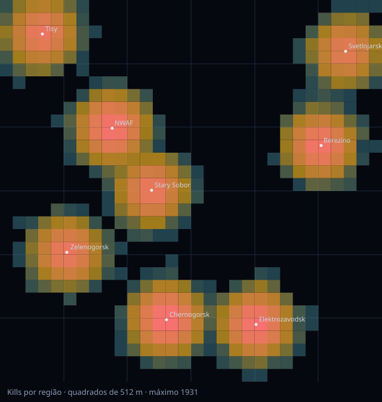

# game-events-mongodb

Guarda cada evento de um servidor de DayZ (kill, morte, dano, conexão, chat) como documento no MongoDB e tira relatório com aggregation pipeline: armas, horário das mortes, tempo jogado por jogador e um mapa de calor de onde as pessoas morrem.



*(mapa gerado com 375 mil eventos sintéticos: os jogadores se concentram em volta das cidades)*

Os eventos têm formatos diferentes entre si: uma kill tem matador, arma e distância, um dano tem parte do corpo e quantidade, um chat tem texto. Num banco relacional isso vira uma tabela cheia de colunas vazias ou uma tabela por tipo. Em documento, cada evento guarda só o que tem, e o mesmo índice serve pra todos.

## Como o documento fica

```json
{
  "type": "kill",
  "ts": "2026-11-08T23:10:35",
  "player": { "id": "rPs5Hn...", "name": "Raposa" },
  "pos": [6550.3, 2585.1], "alt": 7.2,
  "killer": { "id": "LoBo7x...", "name": "Lobo", "pos": [6610.4, 2700.8] },
  "weapon": "AKM", "distance": 134.7,
  "src": { "file": "DayZServer_x64_2026-11-08.ADM", "line": 13 }
}
```

## Decisões

**Validação com `$jsonSchema`.** Mongo não exige schema, mas aceitar qualquer coisa vira bagunça com o tempo. A coleção recusa documento sem tipo, com tipo desconhecido, data como texto, distância negativa ou posição fora do mapa.

E isso pegou uma coisa real: quando importei os logs do meu servidor, a importação parou num documento com `pos: [-3.4e+38, -3.4e+38]`. É o que o DayZ escreve quando não sabe onde o jogador está (desconexão durante crash, por exemplo): o menor `float` que existe. Agora o leitor descarta essa posição e o evento entra sem coordenada, e a importação conta documentos recusados em vez de parar.

**Importar de novo não duplica.** Cada documento guarda arquivo e linha de origem, com índice único nos dois. Rodar a importação de novo no mesmo log dá 0 novos e N repetidos. `insert_many(ordered=False)` faz o lote seguir mesmo quando um documento é recusado.

**Índices:**

| índice | serve pra |
|---|---|
| `{type, ts}` | eventos de um tipo num período |
| `{player.id, ts}` | histórico de um jogador |
| `{killer.id, ts}` (sparse) | kills de um jogador |
| `{pos: "2d"}` | consulta por região (`$geoWithin` com retângulo). É `2d` e não `2dsphere` porque a posição é em metros num mapa plano, não latitude/longitude |
| `{ts}` com TTL | evento mais velho que N dias some sozinho |
| `{src.file, src.line}` único | importação idempotente |

**O que o `explain()` mostrou** (375 mil eventos):

| consulta | sem índice | com índice |
|---|---|---|
| histórico de um jogador (1.969 eventos) | COLLSCAN, 374.463 docs lidos, 470 ms | IXSCAN, 1.969 docs lidos, **6 ms** |
| todas as kills (74.551, 20% da coleção) | COLLSCAN, 374.463 docs lidos, 699 ms | IXSCAN, 74.551 docs lidos, 672 ms |

O índice só faz diferença grande quando a consulta é seletiva. Pegando 20% da coleção ele lê menos documentos, mas o tempo quase não muda, porque o custo é buscar e devolver os 74 mil documentos.

## Relatórios (aggregation pipeline)

Tudo roda no servidor do Mongo, só o resultado volta pro Python.

- **`weapons`**: kills por arma, distância média e máxima, quantas foram pela IA (`$group` com `$cond`).
- **`deaths_by_hour`**: em que hora do dia mais gente morre (`$hour`).
- **`heatmap`**: conta eventos por quadrado de 512 m (`$floor` da coordenada dividida pelo tamanho). O SVG é desenhado em Python puro, sem biblioteca de gráfico.
- **`sessions`**: tempo jogado. Cada desconexão é pareada com o evento anterior do mesmo jogador usando `$setWindowFields` + `$shift`; se o anterior foi uma conexão, é uma sessão e a duração sai com `$dateDiff`.
- **`top_players`**: kills e mortes vêm de campos diferentes (`killer` e `player`), então o pipeline junta as duas listas com `$unionWith` antes de agrupar e calcula o K/D.
- **`rollup_hourly`**: contagem por hora e tipo gravada em outra coleção com `$merge`. Rodar de novo atualiza em vez de duplicar, então dá pra agendar e consultar a coleção pequena em vez da grande.

Tempos com 375 mil eventos: `deaths_by_hour` 0,13 s, `weapons` 0,8 s, `heatmap` 1,2 s, `rollup_hourly` 1,1 s, `top_players` 2,2 s e `sessions` 5,3 s. O `sessions` é o mais lento porque o `$setWindowFields` precisa ordenar 150 mil conexões e desconexões em memória; se virasse problema, a saída seria manter as sessões numa coleção à parte, atualizada na importação.

## Rodando

Precisa de MongoDB 6+ e Python 3.11+.

```
python -m venv .venv
.venv\Scripts\activate
pip install -e ".[dev]"

python -m events ingest caminho/da/pasta/profiles
python -m events generate --count 200000        (eventos sintéticos)
python -m events report weapons                 (ou deaths-by-hour, sessions, top-players, rollup)
python -m events heatmap --out heatmap.svg
python -m events explain
```

`MONGO_URL` (padrão `mongodb://127.0.0.1:27017`), `EVENTS_DB` e `EVENTS_TTL_DAYS` configuram por variável de ambiente.

Com os 5 dias de log do meu servidor entram 493 eventos (294 de dano, 94 conexões, 5 kills...) em 0,2 s.

## Testes

```
pytest
```

15 testes, contra um Mongo de verdade (um banco novo por teste, apagado no fim): leitura do ADM, validação, importação idempotente, sessões, consulta por região, `$merge` idempotente, o mapa de calor e um que confere pelo `explain()` que o índice troca o COLLSCAN por IXSCAN e lê só os documentos que devolve.

No GitHub Actions rodam com um container `mongo:8.0`.
